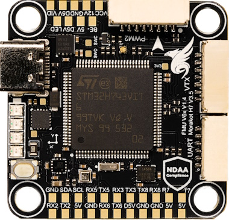
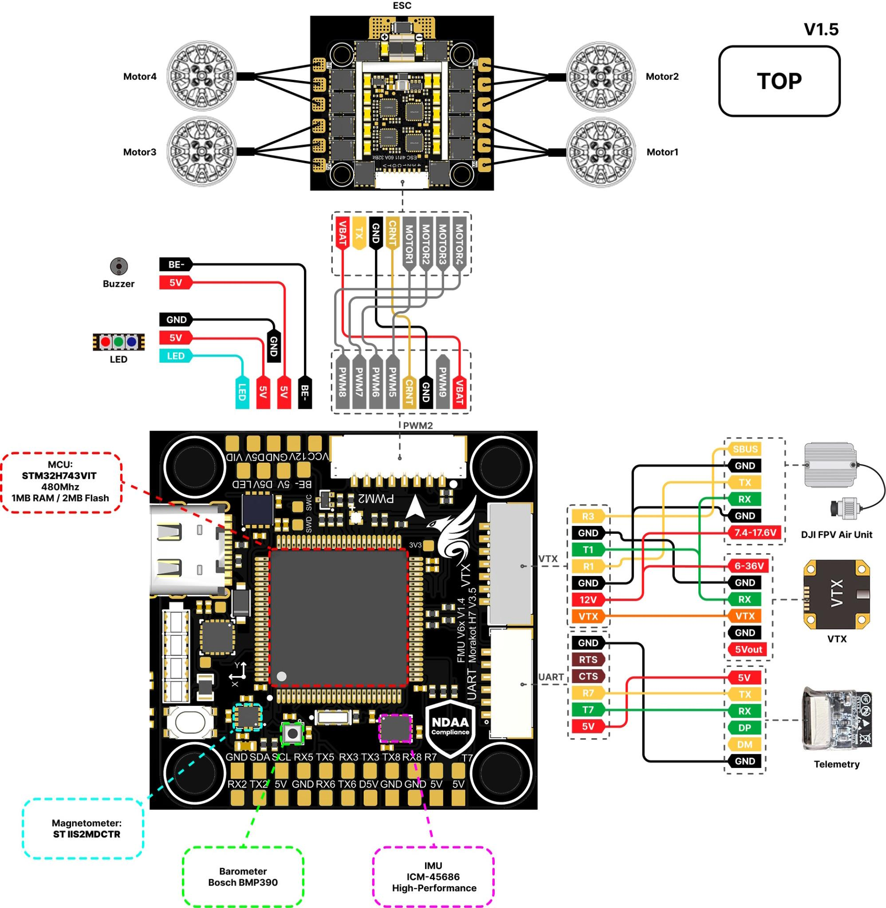
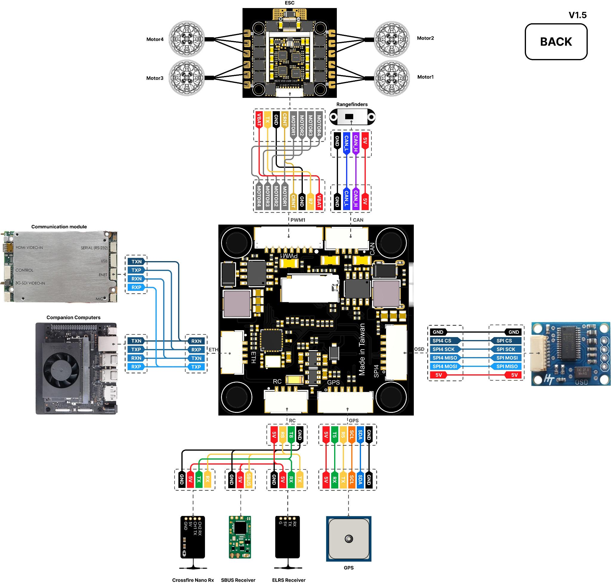

# Morakot Flight Controller Overview

The Morakot is a flight controller designed and produced by [Taiphoon](https://taiphoon.com.tw/)

Morakot Flight Controller - **NDAA-Compliant. Made in Taiwan.** Built for Performance.
Engineered, tested, and manufactured in Taiwan, the Morakot Flight Controller meets full NDAA compliance, ensuring trusted quality and security for professional applications. With an integrated Ethernet interface, it delivers high-speed, reliable connectivity for next-generation FPV and unmanned aerial systems.

## Pinout

## Features

### Sensors

- [ICM-45686 High-Performance IMU](https://invensense.tdk.com/products/motion-tracking/6-axis/icm-45686/)
- [Bosch BMP390 Barometer](https://www.bosch-sensortec.com/products/environmental-sensors/pressure-sensors/bmp390/)
- [ST IIS2MDC Magnetometer](https://www.st.com/en/mems-and-sensors/iis2mdc.html)

### Microprocessor

- [STM32H743VIT MCU](https://www.st.com/en/microcontrollers-microprocessors/stm32h743vi.html)
- 480Mhz / 1MB RAM / 2MB Flash

### Power

- 3S-8S DC Input power
- 5V 2A BEC peripherals power
- 12V 2A BEC video power

### Other

- LED Indicators
- Battery voltage indicator LED
- MicroSD Slot
- 9x motor outputs
- 8x serial ports (USB + 7 UARTs)
- 1x I2C
- 1x CAN
- 1x Ethernet

### UART Mapping

UART Mapping
The UARTs are marked Rn and Tn in the above pinouts. The Rn pin is the receive pin for UARTn. The Tn pin is the transmit pin for UARTn.

| Port | UART   | Protocol          | TX DMA | RX DMA |
|------|--------|-------------------|:------:|:------:|
| 0    | USB    | MAVLink2          |   ✘    |   ✘    |
| 1    | USART1 | MSP DisplayPort   |   ✔    |   ✔    |
| 2    | USART2 | MAVLink2          |   ✔    |   ✔    |
| 3    | USART3 | None              |   ✔    |   ✔    |
| 4    | UART5  | GPS               |   ✔    |   ✔    |
| 5    | USART6 | ESCTelemetry      |   ✔    |   ✔    |
| 6    | UART7  | MAVLink2          |   ✔    |   ✔    |
| 7    | UART8  | RCIN              |   ✔    |   ✔    |

The protocol column lists defaults for firmware built with this board definition. See [OSD Support](#osd-support) for configuration and upgrade instructions.

RTS/CTS flow control is available on UART7.

### VTX Support

The JST-GH 7p connector supports compatible DJI Air Unit / HD VTX devices. SERIAL1 defaults to MSP DisplayPort (`SERIAL1_PROTOCOL=42`). The secondary OSD backend is disabled by default (`OSD_TYPE2=0`); follow [OSD Support](#osd-support) to enable DisplayPort OSD and verify the settings for the connected device.

Pin 1 is VIDEO and pin 2 supplies 12V. Check the connector pin numbering before wiring. Do not connect the 12V supply to a device that cannot tolerate it.

## Additional Information

- Dimensions: 38.5 x 30.5 mm
- Height: up to 8.5 mm
- Mounting: 30.5 x 30.5 mm (M3/M4 with dampers)
- Weight: 7 g

## More Information

- [Morakot Flight Controller](https://taiphoon.com.tw/morakot-flight-controllor)
- [Morakot documentation](https://taiphoon-com.gitbook.io/taiphoon.com-docs)

## Connections

### ESC1 - 8 Pin JST-GH

| Pin | Signal Name     | Voltage      |
|-----|-----------------|--------------|
| 1   | VBAT IN         | 12V-33.6V    |
| 2   | UART6_RX        | 3.3V         |
| 3   | GND             | GND          |
| 4   | CURRENT         | 3.3V         |
| 5   | MOTOR/SERVO 1   | 3.3V         |
| 6   | MOTOR/SERVO 2   | 3.3V         |
| 7   | MOTOR/SERVO 3   | 3.3V         |
| 8   | MOTOR/SERVO 4   | 3.3V         |

### ESC2 - 8 Pin JST-GH

| Pin | Signal Name     | Voltage      |
|-----|-----------------|--------------|
| 1   | VBAT IN         | 12V-33.6V    |
| 2   | MOTOR/SERVO 9   | 3.3V         |
| 3   | GND             | GND          |
| 4   | CURRENT         | 3.3V         |
| 5   | MOTOR/SERVO 5   | 3.3V         |
| 6   | MOTOR/SERVO 6   | 3.3V         |
| 7   | MOTOR/SERVO 7   | 3.3V         |
| 8   | MOTOR/SERVO 8   | 3.3V         |

### CAN - 4 Pin JST-GH

| Pin | Signal Name | Voltage |
|-----|-------------|---------|
| 1   | 5.0V        | 5.0V    |
| 2   | CAN1_H      | 5.0V    |
| 3   | CAN1_L      | 5.0V    |
| 4   | GND         | GND     |

### GPS - 6 Pin JST-GH

| Pin | Signal Name         | Voltage |
|-----|---------------------|---------|
| 1   | 5.0V                | 5.0V    |
| 2   | UART5_TX            | 3.3V    |
| 3   | UART5_RX            | 3.3V    |
| 4   | I2C1_SCL            | 3.3V    |
| 5   | I2C1_SDA            | 3.3V    |
| 6   | GND                 | GND     |

### UART(TELEM) - 6 Pin JST-GH

| Pin | Signal Name           | Voltage |
|-----|-----------------------|---------|
| 1   | 5.0V                  | 5.0V    |
| 2   | UART7_TX              | 3.3V    |
| 3   | UART7_RX              | 3.3V    |
| 4   | UART7_CTS             | 3.3V    |
| 5   | UART7_RTS             | 3.3V    |
| 6   | GND                   | GND     |

### VTX - 7 Pin JST-GH

The connector pinout differs from standard HD VTX cabling. Check every connection before applying power.

| Pin | Signal Name           | Voltage |
|-----|-----------------------|---------|
| 1   | VIDEO                 |         |
| 2   | 12.0V                 | 12.0V   |
| 3   | GND                   | GND     |
| 4   | USART1_RX             | 3.3V    |
| 5   | USART1_TX             | 3.3V    |
| 6   | GND                   | GND     |
| 7   | USART3_RX             | 3.3V    |

### SPI (external OSD or IMU) - 6 Pin JST-SH

| Pin | Signal Name         | Voltage |
|-----|---------------------|---------|
| 1   | 5.0V                | 5.0V    |
| 2   | SPI4_MOSI           | 3.3V    |
| 3   | SPI4_MISO           | 3.3V    |
| 4   | SPI4_SCK            | 3.3V    |
| 5   | SPI4_CS             | 3.3V    |
| 6   | GND                 | GND     |

### RC - 4 Pin JST-GH

| Pin | Signal Name         | Voltage |
|-----|---------------------|---------|
| 1   | 5.0V                | 5.0V    |
| 2   | UART8_RX            | 3.3V    |
| 3   | UART8_TX            | 3.3V    |
| 4   | GND                 | GND     |

### ETH - 4 Pin JST-GH

| Pin | Signal Name         | Voltage |
|-----|---------------------|---------|
| 1   | RXN                 | 3.3V    |
| 2   | RXP                 | 3.3V    |
| 3   | TXN                 | 3.3V    |
| 4   | TXP                 | 3.3V    |

## RC Input

RC input is via SERIAL7(UART8) on the RC connector. Unidirectional protocols can be connected to R8. Bi-Directional Protocols will use the T8 pin also.

- PPM is not supported.
- SBUS/DSM/SRXL connects to the RX8 pin.
- FPort requires connection to TX8. Set [SERIAL7_OPTIONS](https://ardupilot.org/copter/docs/parameters.html#serial7-options-serial7-options) = 7
- CRSF/ELRS also requires both TX8 and RX8 connections and provides telemetry automatically.

In order to use the SBUS pin on the HD VTX connector, you must change SERIAL7_PROTOCOL to something other than "23" and set [SERIAL3_PROTOCOL](https://ardupilot.org/copter/docs/parameters.html#serial3-protocol-serial-3-gps-protocol-selection) to "23".

## PWM Output

The Morakot supports up to 9 PWM outputs with DShot and bidirectional DShot support.

The PWM outputs are in 3 timer groups:

- PWM 1-4 in group1 (TIM1)
- PWM 5-8 in group2 (TIM2)
- PWM 9 in group3 (TIM3)

Channels within the same group need to use the same output rate. If any channel in a group uses DShot then all channels in that group need to use DShot.

## Compass

The Morakot has a built-in IIS2MDC compass. Supported external I2C compasses connected through the GPS connector are detected automatically.

Due to potential interference, an external I2C compass in a GPS/Compass combination is commonly used with the internal compass disabled.

## OSD Support

The onboard analog OSD is enabled by default (`OSD_TYPE=1`). SERIAL1 defaults to MSP DisplayPort (`SERIAL1_PROTOCOL=42`), while the second OSD backend is disabled by default (`OSD_TYPE2=0`). To also use MSP DisplayPort on a compatible HD VTX connected to USART1, set:

- `SERIAL1_PROTOCOL=42`
- `SERIAL1_BAUD=115` (115200 baud)
- `OSD_TYPE2=5`

Reboot after changing the OSD configuration. See the [DisplayPort OSD documentation](https://ardupilot.org/copter/docs/common-displayport.html) for device-specific requirements.

### Upgrading from older firmware

SERIAL1 continues to default to DisplayPort (`SERIAL1_PROTOCOL=42`). The secondary OSD now defaults to disabled (`OSD_TYPE2=0`); older Morakot firmware, including Copter 4.7.2, enabled it by default.

Previously saved parameter overrides are retained. After upgrading, HD VTX users must check and set `SERIAL1_PROTOCOL=42`, `SERIAL1_BAUD=115` and `OSD_TYPE2=5`, then reboot. A previously saved `SERIAL1_PROTOCOL=-1` must be changed to `42` to use DisplayPort.

To stop using DisplayPort while keeping the onboard analog OSD, set `SERIAL1_PROTOCOL=-1` and `OSD_TYPE2=0`, then reboot. After upgrading, also check for a previously saved `OSD_TYPE2=5` and change it to `0` if DisplayPort is not used.

## Battery Monitoring

### Upgrading analog battery monitor calibration

Older Morakot firmware, including Copter 4.7.2, used `SCALE(10)` for the voltage and current ADC inputs. This board definition uses `SCALE(1)`, which changes readings obtained with an existing analog battery monitor calibration.

Back up the parameters before upgrading. After upgrading, verify voltage and current against known measurements and recalibrate the analog battery monitor as needed. Check battery failsafe settings before flight. This ADC scaling change does not apply to digital battery monitors.

## Firmware

Download firmware from the [ArduPilot firmware server](https://firmware.ardupilot.org/) in the `Morakot` directory for your vehicle and release. Check that the selected build includes the fixes described here; older releases may still use the previous defaults.

## Loading Firmware

### Initial installation

To enter DFU mode, hold the boot button while connecting USB. Follow [Loading Firmware to Boards without an ArduPilot Compatible Bootloader](https://ardupilot.org/copter/docs/common-loading-firmware-onto-chibios-only-boards.html) and load the matching `*_with_bl.hex` file for Morakot, such as `arducopter_with_bl.hex` for Copter. This file contains both the main firmware and bootloader.

Once ArduPilot is installed, use the matching `*.apj` file for normal updates through a ground station.
