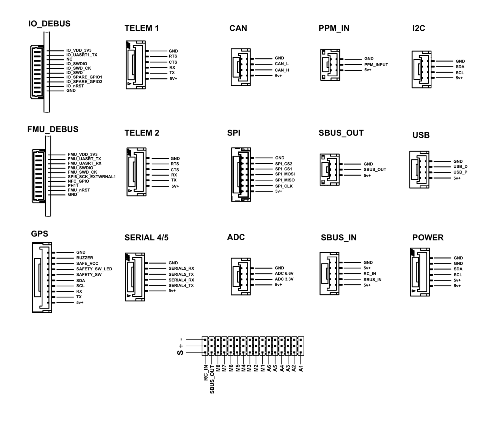

# Simplifly Neo

## Introduction

The Simplifly Neo is a flight controller manufactured by
[MACFOS](https://www.robu.in), based on the
[FMUv6X and Pixhawk Autopilot Bus open source specifications](https://github.com/pixhawk/Pixhawk-Standards),
built around the STM32H753 running at up to 480 MHz with an STM32F103 IO
co-processor.

## Connector pinout



## Where to Buy

Manufactured by [MACFOS LTD](https://www.robu.in) and available from robu.in and
alliance partner portals.

**Purchase link:** *(to be added at launch)*

## Features

- STM32H753 main processor, 2 MB flash, 1 MB RAM
- STM32F103 IOMCU co-processor with bidirectional DShot
- Temperature-controlled IMU with a regulated heater
- FRAM-backed parameter storage
- Triple redundant power inputs with brick-valid sensing
- CAN, microSD logging, external SPI and I2C connectors
- 14 PWM outputs: 8 main (M1-M8, IOMCU) and 6 auxiliary (A1-A6, FMU)

## Specifications

- **Processor**
  - STM32H753IIK6 (Cortex-M7, 480 MHz, 2 MB flash, 1 MB RAM)
  - STM32F103 IOMCU

- **Sensors**
  - Bosch BMI088 accelerometer + gyroscope (SPI3)
  - Bosch BMP390 barometer (internal I2C, 0x77) — driven by the `BMP388`
    driver, which is register compatible (chip id `0x60`)
  - Bosch BMM150 magnetometer (internal I2C, 0x10)
  - Ramtron FRAM for parameter storage (SPI5)

  The IMU carries a regulated heater (`HAL_IMU_TEMP_DEFAULT 45`), with magnetic
  compensation applied for the field the heater generates at the BMM150.

  Note this board has a **single IMU**. There is no IMU redundancy and the EKF
  runs a single lane.

- **Power**
  - Three power brick inputs, each with valid sensing
  - INA2xx-based power monitor (I2C bus 1), default battery monitor type 21
  - Independent peripheral and high-power 5 V rails, each with software enable
    and over-current sensing

- **Interfaces**
  - 7 serial ports (2 USB CDC, 5 on external connectors)
  - 1x CAN
  - microSD card slot (SDMMC2)
  - 8 main PWM outputs (M1-M8) from the IOMCU, 6 auxiliary (A1-A6) from the FMU
  - External SPI connector on SPI6, with two chip selects
  - External I2C connector on I2C3
  - RC input and SBUS output, on the same header as the PWM outputs
  - Safety switch with LED, buzzer, RGB status LED
  - Spektrum / DSM power control
  - 4 scaled analog inputs plus 3.3 V and 6.6 V ADC pins on the AD&IO connector

## Serial port mapping

| Serial | Port | Default use |
|---|---|---|
| SERIAL0 | OTG1 | USB console |
| SERIAL1 | UART7 | Telem1 (flow control) |
| SERIAL2 | UART5 | Telem2 (flow control) |
| SERIAL3 | USART1 | GPS1 |
| SERIAL4 | USART2 | SERIAL4/5 connector |
| SERIAL5 | USART3 | SERIAL4/5 connector, also on the FMU debug header |
| SERIAL6 | OTG2 | MAVLink2 (second USB CDC) |

USART6 is reserved for the IOMCU link and is not exposed as a serial port.

TELEM1 and TELEM2 carry RTS/CTS. The SERIAL4/5 connector carries TX and RX for
both ports only, with no flow control lines.

## I2C buses

| ArduPilot bus | Peripheral | Devices |
|---|---|---|
| 0 | I2C4 (internal) | BMM150 magnetometer, BMP390 barometer, SE050 secure element, 24LC64 EEPROM |
| 1 | I2C1 | GPS1 connector — external compass, INA2xx power monitor |
| 2 | I2C3 | External I2C connector, 24LC64 EEPROM |

## PWM outputs

The output header carries 16 pins, in this order:

| Pins | Driven by | ArduPilot outputs |
|---|---|---|
| A1-A6 | FMU | SERVO9-14 |
| M1-M8 | IOMCU | SERVO1-8 |
| SBUS_OUT | IOMCU | - |
| RC_IN | IOMCU | - |

The eight main outputs M1-M8 are driven by the IO co-processor and are the
first eight ArduPilot outputs, so a standard multicopter motor layout maps to
M1-M8 directly. The six auxiliary outputs A1-A6 come from the FMU.

All 14 outputs support DShot, and bi-directional DShot is available on the
IOMCU outputs.

## RC input

RC input is handled by the IOMCU and supports all ArduPilot RC protocols. The
SBUS input reaches the IOMCU through a hardware inverter.

## Building

```bash
./waf configure --board SimpliflyNeo
./waf copter
```

## Loading firmware

The board ships with the ArduPilot bootloader. Firmware is loaded over USB from
a ground station, or over SWD for first-time bring-up.
